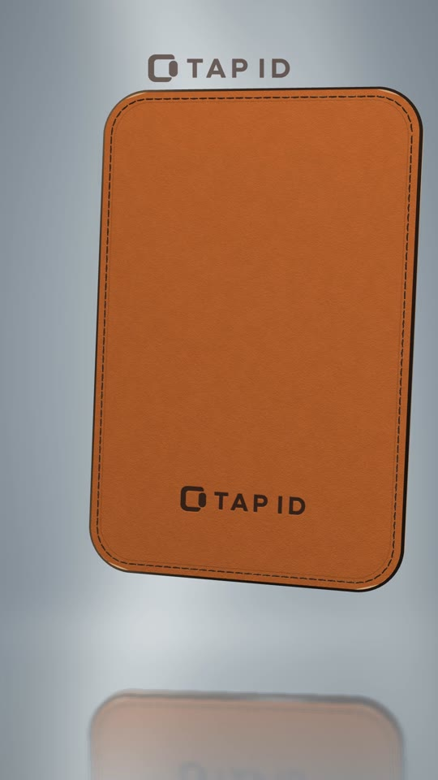

# TAP ID

Brand and product design assets for TAP ID, featuring the Saddle Signature palette.

[Casing](#01-casing-card-design) · [Packaging](#02-packaging-design) · [Booth](#03-booth-design) · [Cards](#04-cards-design) · [Palette](#05-color-palette) · [Motion](#06-motion-video) · [Logo](#07-logo)

## 01. Casing Card Design

Caramel leather, dark perimeter stitching and a recessed TAP ID logo. The back stays plain.

## 02. Packaging Design

| P08 · Corner Portfolio | P02 · Signature Book Box |
| :---: | :---: |
|  |  |

Two packaging formats in seven colors, with exploded views and vendor guides.

## 03. Booth Design

| Front view | Overhead perspective |
| :---: | :---: |
|  |  |

B01 · A 2 × 2 m booth concept in Espresso and Ivory.

## 04. Cards Design

| D04 · Open Portal | D06 · Framework |
| :---: | :---: |
|  |  |

Two card designs in seven Saddle Signature colors.

## 05. Color Palette

| Espresso | Saddle Brown | Tan | Sand | Ivory | Black | White |
| :---: | :---: | :---: | :---: | :---: | :---: | :---: |
| `#3F281F` | `#8B5A3C` | `#C59A70` | `#E3D3BD` | `#F6F0E7` | `#000000` | `#FFFFFF` |

## 06. Motion Video

Four portrait 3D motion designs with music and scan effects. **1080 × 1920 · 60 fps.**

13 · Silver Flow · [15 s](06.%20Motion%20Video/15%20Seconds/13.%20Silver%20Flow%20-%2015%20Seconds.mp4) · [30 min](06.%20Motion%20Video/30%20Minutes/13.%20Silver%20Flow%20-%2030%20Minutes.mp4)

## 07. Logo

Symbols, wordmarks and transparent versions.

## Asset Index

| Collection | Contents | Files |
| --- | --- | ---: |
| [01. Casing Card Design](01.%20Casing%20Card%20Design/) | Final casing, earlier studies and technical references | 37 |
| [02. Packaging Design](02.%20Packaging%20Design/) | Mockups, exploded views and vendor PDFs | 18 |
| [03. Booth Design](03.%20Booth%20Design/) | Renders, floor plans and catalog | 5 |
| [04. Cards Design](04.%20Cards%20Design/) | Mockups and front/back print files | 42 |
| [05. Color Palette](05.%20Color%20Palette/) | Saddle Signature palette | 1 |
| [06. Motion Video](06.%20Motion%20Video/) | Four short videos and four exhibition loops | 8 |
| [07. Logo](07.%20Logo/) | Symbols, wordmarks and transparent versions | 14 |
| **Total** | **107 PNG · 6 SVG · 4 PDF · 8 MP4** | **125** |

[Open Google Drive](https://drive.google.com/drive/folders/1gf0f-z-4uAVuuePL4lLbPGWla0QeRjrs)
